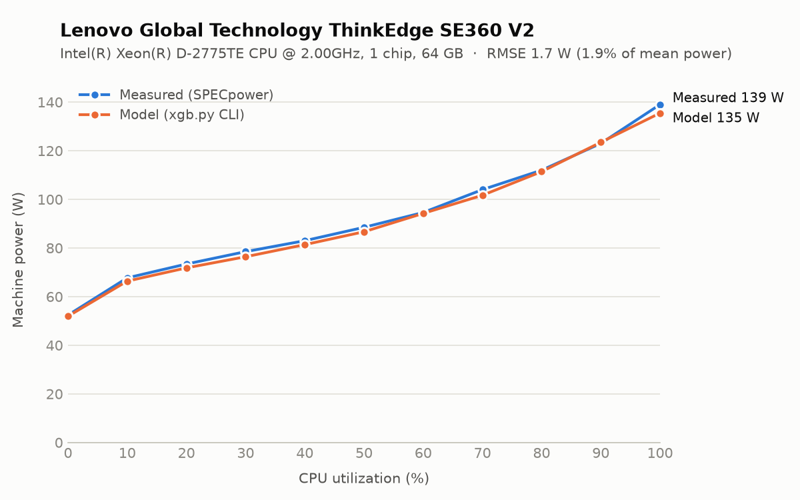
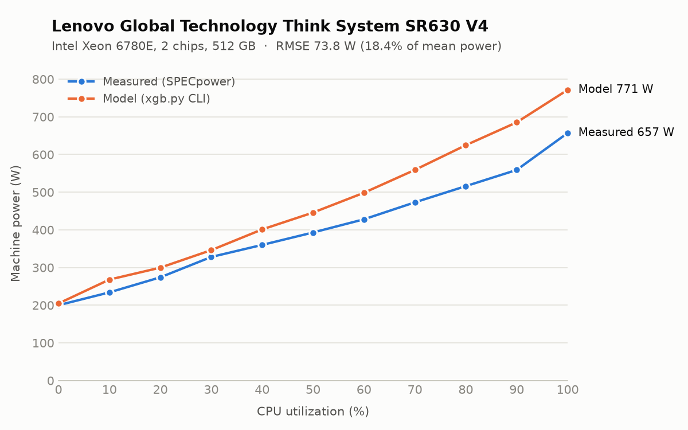
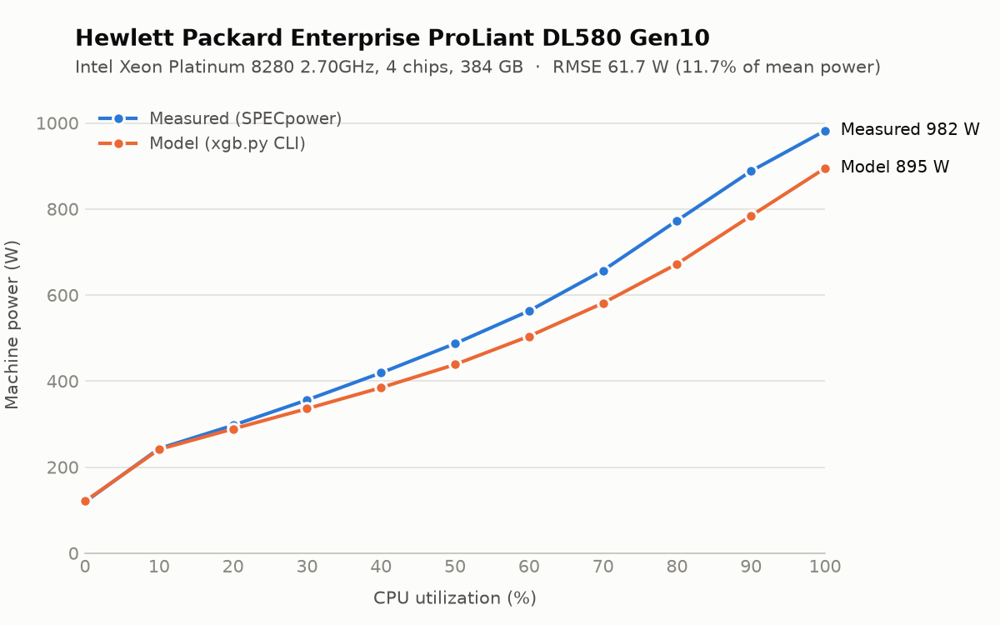
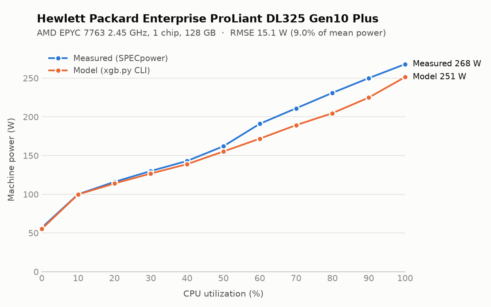
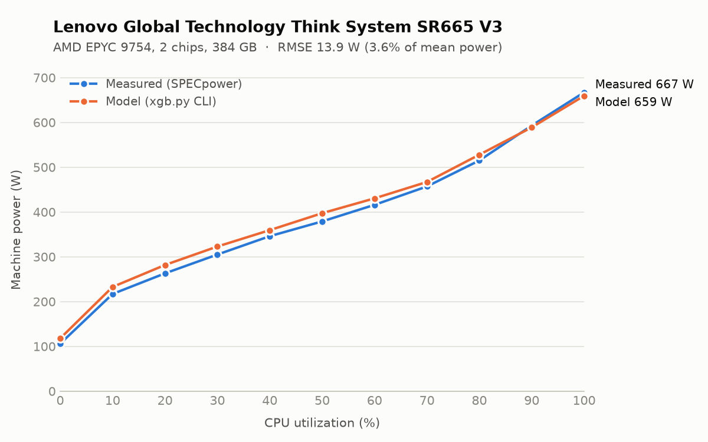
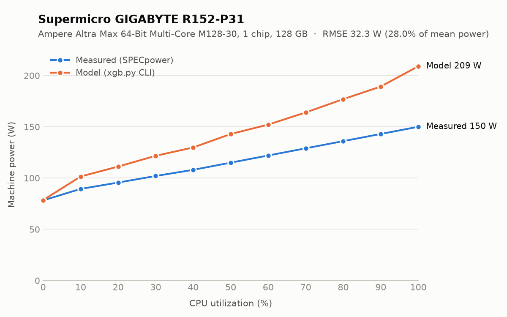

# Validating `xgb.py` in sample

Six machines from the training data were run through the `xgb.py` CLI, and the output was compared with the measured SPECpower power at every 10% utilization step.

## Summary

- **RMSE across the six machines ranges from 1.7 W to 73.8 W**, or 1.9% to 28.0% of the machine's mean measured power.
- **The interpolation bug is fixed.** The CLI used to return the midpoint of the prediction at each 10% step and the step below. Across all 489 machines, the fix cuts median RMSE from 22.0 W to 10.7 W and removes a 5.2% overall underestimate. All numbers in this document are from the fixed version unless marked otherwise.
- **Almost all of the remaining error comes from the data.** 374 of 489 machines share their exact CLI inputs with at least one other machine, but their measured power differs. The model cannot tell them apart and predicts close to their average. Across all machines, this accounts for 99.5% of the squared error.
- **This does not measure accuracy on unseen hardware.** The model was trained on these same machines, so these errors are optimistic for machines outside the training data.

## Method

- **Data:** `spec-power-data/data/spec_data_cleaned.csv` at submodule commit `b5844e2`. It holds 489 machines, each measured at 0, 10 … 100% utilization.
- **Sample selection:** one machine from each of six make and chip-count groups: the machine at the median of that group's measured power at 100% load. The rule was fixed before any model output was seen. Nvidia (1 machine), 2-chip Ampere (2 machines) and 8-chip Intel (7 machines) are not covered.
- **Model calls:** each call to `xgb.py` trains its own model, so every sample has its own model. All eight machine flags were passed, with values taken from that machine's CSV row. `--cpu-chips` limits the training data to machines with that chip count.
- **Utilization input:** the values 0, 10 … 100 were sent on stdin, as in normal streaming use. Running each command twice gave identical output.
- **Metric:** RMSE = √(mean((model − measured)²)) over the 11 utilization steps.
- **Environment:** Python 3.13.5 on Linux aarch64, using `xgboost==3.4.1` and the other pins from `requirements.txt`. On aarch64 the requirements install `xgboost` rather than `xgboost-cpu`, so x86_64 results could differ slightly.

## Samples and CLI calls

| Group | Result ID | Machine | CPU | Machines in training data |
|---|---|---|---|---|
| Intel, 1 chip | `power_ssj2008-20240130-01363` | Lenovo Global Technology ThinkEdge SE360 V2 | Intel(R) Xeon(R) D-2775TE CPU @ 2.00GHz | 173 |
| Intel, 2 chips | `power_ssj2008-20250224-01499` | Lenovo Global Technology Think System SR630 V4 | Intel Xeon 6780E | 268 |
| Intel, 4 chips | `power_ssj2008-20190311-00882` | Hewlett Packard Enterprise ProLiant DL580 Gen10 | Intel Xeon Platinum 8280 2.70GHz | 41 |
| AMD, 1 chip | `power_ssj2008-20210221-01066` | Hewlett Packard Enterprise ProLiant DL325 Gen10 Plus | AMD EPYC 7763 2.45 GHz | 173 |
| AMD, 2 chips | `power_ssj2008-20240327-01388` | Lenovo Global Technology Think System SR665 V3 | AMD EPYC 9754 | 268 |
| Ampere, 1 chip | `power_ssj2008-20230522-01260` | Supermicro GIGABYTE R152-P31 | Ampere Altra Max 64-Bit Multi-Core Processor M128-30 | 173 |

Vendor and model names are copied as they appear in the CSV. The Ampere entry lists vendor Supermicro with a Gigabyte model name.

Every call has this form, followed by the flags below:

```bash
printf '%s\n' 0 10 20 30 40 50 60 70 80 90 100 | python3 xgb.py --silent <flags>
```

| Group | Flags |
|---|---|
| Intel, 1 chip | `--cpu-make intel --cpu-chips 1 --cpu-cores 16 --cpu-threads 32 --cpu-freq 2000 --tdp 100 --ram 64 --release-year 2023` |
| Intel, 2 chips | `--cpu-make intel --cpu-chips 2 --cpu-cores 288 --cpu-threads 288 --cpu-freq 2200 --tdp 330 --ram 512 --release-year 2024` |
| Intel, 4 chips | `--cpu-make intel --cpu-chips 4 --cpu-cores 112 --cpu-threads 224 --cpu-freq 2700 --tdp 205 --ram 384 --release-year 2019` |
| AMD, 1 chip | `--cpu-make amd --cpu-chips 1 --cpu-cores 64 --cpu-threads 128 --cpu-freq 2450 --tdp 280 --ram 128 --release-year 2021` |
| AMD, 2 chips | `--cpu-make amd --cpu-chips 2 --cpu-cores 256 --cpu-threads 512 --cpu-freq 2250 --tdp 360 --ram 384 --release-year 2023` |
| Ampere, 1 chip | `--cpu-make ampere --cpu-chips 1 --cpu-cores 128 --cpu-threads 128 --cpu-freq 3000 --tdp 250 --ram 128 --release-year 2022` |

## RMSE per model

| Group | RMSE (W) | RMSE (% of mean power) | Mean error (W) | Largest error (W) | At utilization | RMSE percentile among all 489 machines |
|---|---:|---:|---:|---:|---:|---:|
| Intel, 1 chip | 1.7 | 1.9% | -1.4 | 3.5 | 100% | 14 |
| Intel, 2 chips | 73.8 | 18.4% | +62.0 | 126.3 | 90% | 95 |
| Intel, 4 chips | 61.7 | 11.7% | -49.0 | 104.0 | 90% | 92 |
| AMD, 1 chip | 15.1 | 9.0% | -11.5 | 26.3 | 80% | 57 |
| AMD, 2 chips | 13.9 | 3.6% | +11.1 | 18.7 | 20% | 56 |
| Ampere, 1 chip | 32.3 | 28.0% | +28.1 | 59.0 | 100% | 77 |

Mean error is model minus measured, so a negative value means the model underestimates. The percentile is by RMSE in watts; a higher value means a larger error than most machines.

**How typical these six are:** they run worse than the full data. Their median relative RMSE is 10.3%, against 4.3% for all 489 machines, using the same training and interpolation code. Median RMSE for all machines is 10.7 W and the 90th percentile is 58.1 W. Use the full-data figures as the general picture and the six below as worked examples.

## Findings

### 1. Interpolation shifted the CLI output by half a step (fixed)

`interpolate_predictions` in `xgb.py` used to interpolate between anchors at 0, 5, 15, 25 … 95, 100, which overwrote the model's own predictions at 10, 20 … 90. The training data only has utilization in steps of 10, so a prediction at 15 was the same as the prediction at 10. The old CLI output was therefore:

```
CLI(u) = (model(u - 10) + model(u)) / 2    for u = 10, 20 ... 90
```

Power rises with utilization, so the old output read below the model at every step except 0% and 100%. The anchors are now 0, 10, 20 … 100, so the CLI returns the model's prediction at each of these steps. This was confirmed on all six machines.

| Group | RMSE before (W) | RMSE after (W) |
|---|---:|---:|
| Intel, 1 chip | 5.0 | 1.7 |
| Intel, 2 chips | 55.9 | 73.8 |
| Intel, 4 chips | 91.5 | 61.7 |
| AMD, 1 chip | 22.1 | 15.1 |
| AMD, 2 chips | 18.0 | 13.9 |
| Ampere, 1 chip | 28.4 | 32.3 |
| **All 489 machines, median** | **22.0** | **10.7** |

Across all machines:

- **RMSE:** the fix lowers RMSE on 381 of 489 machines (78%).
- **Unique inputs:** on the 115 machines whose inputs are unique, median RMSE fell from 16.0 W to 2.0 W.
- **Bias:** the mean error over all machines went from -18.5 W to 0.0 W.
- **Machines that got worse:** RMSE rises on the other 108 machines, including the Intel 2-chip and Ampere samples. Both samples draw less than the average of machines with the same inputs, and the old downward shift happened to cancel part of that overestimate.

This validation only covers the 10% steps, because the source data has no measurements between them. Values between the steps also changed, and their accuracy is not measured here.

### 2. Identical inputs, different measured power

The model only sees the CLI flags, so machines with the same flags get the same prediction. The best any model could do for them is their average curve. The last column below shows the RMSE of that average against the sample, which is roughly the error limit for these inputs.

| Group | Machines with identical inputs | Measured power at 100% across them (W) | RMSE, model (W) | RMSE, average of those machines (W) |
|---|---:|---:|---:|---:|
| Intel, 1 chip | 4 | 134–139 | 1.7 | 1.6 |
| Intel, 2 chips | 4 | 657–906 | 73.8 | 75.1 |
| Intel, 4 chips | 3 | 808–982 | 61.7 | 61.7 |
| AMD, 1 chip | 6 | 228–272 | 15.1 | 15.1 |
| AMD, 2 chips | 13 | 591–800 | 13.9 | 13.7 |
| Ampere, 1 chip | 2 | 150–268 | 32.3 | 32.3 |

The last two columns nearly match, so on these six the model has already learned about as much as these inputs allow. The same holds across the full data: the spread within groups of identical inputs accounts for 99.5% of the model's squared error. Better tuning would not reduce this. It would take new inputs that explain the difference.

The clearest case is Ampere: `power_ssj2008-20230522-01260` and `power_ssj2008-20230522-01257` have identical flags, yet draw 150 W and 268 W at 100%. The model predicts 209 W, which is their midpoint. The CSV does not show why two entries with the same flags differ this much.

## Comparison per machine

### Intel, 1 chip: Intel(R) Xeon(R) D-2775TE CPU @ 2.00GHz

`power_ssj2008-20240130-01363`, RMSE 1.7 W



| Utilization (%) | Measured (W) | Model (W) | Error (W) |
|---:|---:|---:|---:|
| 0 | 52.4 | 51.9 | -0.5 |
| 10 | 67.7 | 66.4 | -1.3 |
| 20 | 73.4 | 71.8 | -1.6 |
| 30 | 78.5 | 76.4 | -2.1 |
| 40 | 83.0 | 81.4 | -1.6 |
| 50 | 88.5 | 86.7 | -1.8 |
| 60 | 94.6 | 94.2 | -0.4 |
| 70 | 104.0 | 101.7 | -2.3 |
| 80 | 112.0 | 111.4 | -0.6 |
| 90 | 123.0 | 123.5 | +0.5 |
| 100 | 139.0 | 135.5 | -3.5 |

### Intel, 2 chips: Intel Xeon 6780E

`power_ssj2008-20250224-01499`, RMSE 73.8 W



| Utilization (%) | Measured (W) | Model (W) | Error (W) |
|---:|---:|---:|---:|
| 0 | 200.0 | 204.6 | +4.6 |
| 10 | 234.0 | 268.0 | +34.0 |
| 20 | 274.0 | 299.7 | +25.7 |
| 30 | 328.0 | 346.1 | +18.1 |
| 40 | 360.0 | 401.1 | +41.1 |
| 50 | 393.0 | 445.9 | +52.9 |
| 60 | 428.0 | 498.4 | +70.4 |
| 70 | 473.0 | 559.1 | +86.1 |
| 80 | 516.0 | 624.7 | +108.7 |
| 90 | 559.0 | 685.3 | +126.3 |
| 100 | 657.0 | 771.5 | +114.5 |

### Intel, 4 chips: Intel Xeon Platinum 8280 2.70GHz

`power_ssj2008-20190311-00882`, RMSE 61.7 W



| Utilization (%) | Measured (W) | Model (W) | Error (W) |
|---:|---:|---:|---:|
| 0 | 119.0 | 120.6 | +1.6 |
| 10 | 243.0 | 241.1 | -1.9 |
| 20 | 297.0 | 288.7 | -8.3 |
| 30 | 356.0 | 335.8 | -20.2 |
| 40 | 419.0 | 384.6 | -34.4 |
| 50 | 487.0 | 438.4 | -48.6 |
| 60 | 563.0 | 504.0 | -59.0 |
| 70 | 657.0 | 581.2 | -75.8 |
| 80 | 773.0 | 672.3 | -100.7 |
| 90 | 888.0 | 784.0 | -104.0 |
| 100 | 982.0 | 894.7 | -87.3 |

### AMD, 1 chip: AMD EPYC 7763 2.45 GHz

`power_ssj2008-20210221-01066`, RMSE 15.1 W



| Utilization (%) | Measured (W) | Model (W) | Error (W) |
|---:|---:|---:|---:|
| 0 | 56.8 | 55.2 | -1.6 |
| 10 | 100.0 | 99.8 | -0.2 |
| 20 | 116.0 | 113.9 | -2.1 |
| 30 | 130.0 | 126.8 | -3.2 |
| 40 | 143.0 | 138.9 | -4.1 |
| 50 | 162.0 | 155.2 | -6.8 |
| 60 | 191.0 | 171.8 | -19.2 |
| 70 | 211.0 | 189.3 | -21.7 |
| 80 | 231.0 | 204.7 | -26.3 |
| 90 | 250.0 | 224.9 | -25.1 |
| 100 | 268.0 | 251.3 | -16.7 |

### AMD, 2 chips: AMD EPYC 9754

`power_ssj2008-20240327-01388`, RMSE 13.9 W



| Utilization (%) | Measured (W) | Model (W) | Error (W) |
|---:|---:|---:|---:|
| 0 | 106.0 | 117.8 | +11.8 |
| 10 | 217.0 | 232.7 | +15.7 |
| 20 | 263.0 | 281.7 | +18.7 |
| 30 | 305.0 | 322.9 | +17.9 |
| 40 | 346.0 | 359.5 | +13.5 |
| 50 | 379.0 | 397.3 | +18.3 |
| 60 | 416.0 | 430.5 | +14.5 |
| 70 | 457.0 | 467.0 | +10.0 |
| 80 | 515.0 | 527.9 | +12.9 |
| 90 | 593.0 | 588.9 | -4.1 |
| 100 | 667.0 | 659.3 | -7.7 |

### Ampere, 1 chip: Ampere Altra Max 64-Bit Multi-Core Processor M128-30

`power_ssj2008-20230522-01260`, RMSE 32.3 W



| Utilization (%) | Measured (W) | Model (W) | Error (W) |
|---:|---:|---:|---:|
| 0 | 78.2 | 78.4 | +0.2 |
| 10 | 89.4 | 101.5 | +12.1 |
| 20 | 95.6 | 111.2 | +15.6 |
| 30 | 102.0 | 121.7 | +19.7 |
| 40 | 108.0 | 129.8 | +21.8 |
| 50 | 115.0 | 142.9 | +27.9 |
| 60 | 122.0 | 152.1 | +30.1 |
| 70 | 129.0 | 164.0 | +35.0 |
| 80 | 136.0 | 177.0 | +41.0 |
| 90 | 143.0 | 189.3 | +46.3 |
| 100 | 150.0 | 209.0 | +59.0 |
